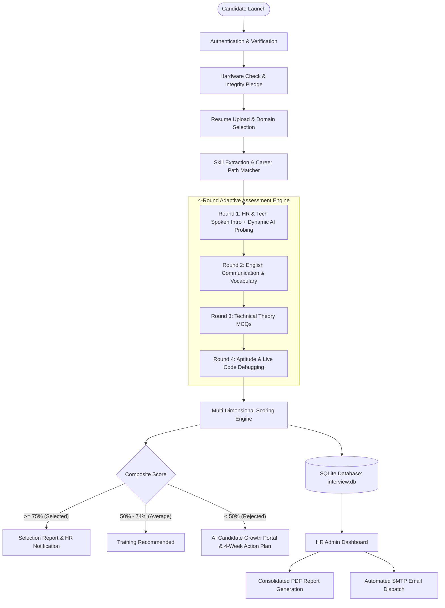

# 🎯 SMART HIRE AI — Adaptive Recruitment & Assessment Platform

[](https://www.python.org/)
[](https://streamlit.io/)
[](https://ai.google.dev/)
[](https://www.sqlite.org/)
[](LICENSE)

**SMART HIRE AI** is an intelligent, automated end-to-end recruitment platform designed to modernize candidate screening and interviews. Powered by **Google Gemini 2.5 Flash**, **Speech Recognition**, **Text-to-Speech (gTTS)**, and an **AST-sandboxed code execution engine**, the platform autonomously evaluates applicants across verbal communication, technical competence, analytical aptitude, and hands-on coding challenges.

Instead of generic rejection screens, candidates who do not meet initial benchmarks receive an **AI Candidate Growth Portal** featuring a personalized 4-week structured action plan, curated learning roadmaps, and an interactive coding practice sandbox.

---

## 📌 Table of Contents

- [Key Features](#-key-features)
- [System Architecture & Assessment Flow](#-system-architecture--assessment-flow)
- [Project Directory Structure](#-project-directory-structure)
- [Technology Stack](#-technology-stack)
- [Installation & Setup](#-installation--setup)
- [Configuration (.env & secrets.toml)](#-configuration)
- [How to Run](#-how-to-run)
- [Default Administrative Access](#-default-administrative-access)
- [Security & Sandboxing Architecture](#-security--sandboxing-architecture)
- [License](#-license)

---

## ✨ Key Features

### 1. 📄 Multi-Format Resume Parsing & Skill Extraction
- Supports **PDF**, **DOCX**, **TXT**, and resume images (**PNG**, **JPG**, **JPEG** via Gemini Vision OCR).
- Leverages regex-isolated keyword matching across programming languages, web frameworks, cloud/DevOps technologies, databases, and AI/ML libraries.

### 2. 🎯 AI Career Path Synergy Matcher
- Analyzes candidate skill profiles against **26 industry career domains** (e.g., Software Engineering, Data Science, DevOps, Cloud Computing, Cybersecurity).
- Intelligently recommends role track changes if an applicant's resume demonstrates superior synergy with an alternate domain, complete with an AI-generated justification.

### 3. 🛡️ Proctoring & Integrity Control Center
- Hardware verification checks for audio microphone, network streaming, and grading modules.
- Enforces an applicant honor pledge and 7 proctoring compliance rules.
- **Client-Side Anti-Cheating Guard:** Real-time JavaScript monitoring for browser tab switches (`visibilitychange`) and fullscreen exit events (`fullscreenchange`), enforcing a 3-strike policy that auto-terminates compromised sessions.

### 4. 🎤 4-Round Adaptive Assessment Engine
- **Round 1: Spoken Introduction & Technical Probing**
  - Text-to-speech audio narration using `gTTS`.
  - Candidate voice recording and transcription via `speech_recognition`.
  - **Dynamic AI Follow-Up Generator:** Gemini analyzes spoken claims (e.g., mention of specific architectures, caching systems, or algorithms) and dynamically generates deep, probing technical questions in real time.
- **Round 2: English Communication & Vocabulary**
  - Spoken fluency, pronunciation, grammar, and articulation evaluation combined with vocabulary MCQs.
- **Round 3: Core Technical MCQs**
  - Category-based technical multiple-choice challenges covering Operating Systems, Databases, Data Structures, and Computer Networking.
- **Round 4: Analytical Aptitude & Live Code Debugging**
  - Algorithmic puzzles and real-world code debugging challenges in Python, C++, and Java.
  - Safe local Python compilation with compiler simulation for compiled languages.

### 5. 🌱 Candidate Growth & Mentorship Portal
- Applicants receiving a developing/rejection outcome are unlocked into a personal growth dashboard:
  - **Diagnostic Breakdown:** Radial and bar metrics across Communication, CS Theory, Aptitude, Coding Logic, and Behavioral Articulation.
  - **4-Week Structured Checklist:** Interactive week-by-week milestones with checkboxes.
  - **Curated Study Guide:** Domain-specific documentation, tutorials, and academic papers.
  - **Interactive Coding Sandbox:** Safe in-browser code editor and runner for practice challenges.
  - **Personal Recruiter Encouragement Note:** AI-generated motivational feedback.

### 6. 💼 HR Recruiter Command Panel
- Live candidate overview with composite score rankings and skill-tag search filters.
- **Consolidated PDF Export:** Auto-generates branded, multi-page candidate evaluation dossiers using `reportlab`.
- **Automated Communication Center:** One-click automated SMTP dispatch of formal selection offers or personalized mentorship roadmaps.
- **Data Governance:** Secure permanent candidate data deletion and SQLite sequence maintenance.

---

## 🏛️ System Architecture & Assessment Flow



---

## 📂 Project Directory Structure

```text
AI_INT_SYSTEM/
│
├── .streamlit/
│   └── secrets.toml             # Streamlit secrets configuration (SMTP, API keys)
│
├── app.py                       # Main application entry point, session router, global CSS
├── auth.py                      # PBKDF2 authentication, SQLite schema init, SMTP dispatcher
├── interview.py                 # 4-round interview engine, voice TTS/STT, AI scoring
├── hr_panel.py                  # HR Recruiter dashboard, analytics, ReportLab PDF generator
├── instructions.py              # Pre-assessment hardware checks, rules, and honor pledge
├── resume.py                    # Multi-format resume parsing (PDF, DOCX, TXT, Vision OCR)
├── skills.py                    # Technical skill dictionary & 26-domain career matching engine
├── results.py                   # Candidate-facing assessment report & multi-metric review
├── sandbox.py                   # Secure code execution sandbox (AST analysis + isolated runner)
├── reset_db.py                  # Database maintenance and table cleanup utility
│
├── .env.example                 # Environment configuration template
├── .gitignore                   # Version control exclusions (secrets, db, cache, reports)
├── requirements.txt             # Project Python dependencies
└── interview.db                 # SQLite relational database (WAL mode)
```

---

## 🛠️ Technology Stack

| Layer | Technologies |
| :--- | :--- |
| **Frontend & UI** | [Streamlit](https://streamlit.io/) (Custom Glassmorphism Dark CSS), HTML5 Audio, JavaScript |
| **AI / LLM Engine** | [Google Gemini 2.5 Flash](https://ai.google.dev/) (`google-generativeai`) |
| **Speech & Audio** | `gTTS` (Text-to-Speech), `SpeechRecognition` (Google STT), `audio-recorder-streamlit` |
| **Document Processing** | `pdfplumber` (PDF), `python-docx` (Word), `Pillow` (Images), `ReportLab` (PDF Generation) |
| **Code Sandboxing** | Python AST (`ast` module) static analysis, isolated temporary workspace subprocesses |
| **Database** | SQLite 3 (WAL Journaling Mode, Relational 3NF Schema) |
| **Security & Auth** | Salted PBKDF2-HMAC-SHA256 (100,000 iterations), TLS SMTP Email Dispatch |

---

## 🚀 Installation & Setup

### 1. Prerequisites
- Python **3.10** or higher installed.
- Working microphone for voice evaluation rounds.
- Internet connection (for Google Gemini AI, Speech Recognition, and SMTP relay).

### 2. Clone the Repository
```bash
git clone https://github.com/phsarvesh765-max/AI_INT_SYSTEM.git
cd AI_INT_SYSTEM
```

### 3. Create and Activate a Virtual Environment
```bash
# Windows (PowerShell)
python -m venv .venv
.\.venv\Scripts\Activate.ps1

# Linux / macOS
python3 -m venv .venv
source .venv/bin/activate
```

### 4. Install Dependencies
```bash
pip install -r requirements.txt
```

---

## ⚙️ Configuration

Copy the `.env.example` file to `.env`:
```bash
cp .env.example .env
```

Open `.env` and fill in your credentials:
```ini
# Google Gemini API Key (Get yours at https://aistudio.google.com/)
GEMINI_API_KEY=your_gemini_api_key_here

# SMTP Email Configuration (Used for verification OTPs and candidate roadmaps)
SMTP_SERVER=smtp.gmail.com
SMTP_PORT=587
SMTP_USER=your_email@gmail.com
# Use a 16-character Google App Password (not your primary Gmail password)
SMTP_PASS=your_google_app_password
```

> **Alternatively**, you can configure credentials inside `.streamlit/secrets.toml`:
> ```toml
> GEMINI_API_KEY = "your_gemini_api_key_here"
> SMTP_SERVER = "smtp.gmail.com"
> SMTP_PORT = 587
> SMTP_USER = "your_email@gmail.com"
> SMTP_PASS = "your_google_app_password"
> ```

---

## 🖥️ How to Run

Launch the Streamlit application directly from the repository root:

```bash
streamlit run app.py
```

The application will open automatically in your browser at `http://localhost:8501`.

---

## 🔑 Default Administrative Access

The database is pre-seeded with a default HR Admin account upon first run:

| Field | Value |
| :--- | :--- |
| **Role** | `HR Admin` |
| **Username** | `admin` |
| **Password** | `Admin@123` *(or your registered admin password)* |
| **Email** | `admin@smarthire.com` |

*Applicants can self-register using the **Sign Up** tab with email OTP verification.*

---

## 🔒 Security & Sandboxing Architecture

1. **AST-Enforced Sandbox (`sandbox.py`):**
   - User-submitted Python code undergoes static Abstract Syntax Tree (AST) inspection before compilation.
   - Prohibits system-level imports (`os`, `sys`, `subprocess`, `shutil`, `socket`, `sqlite3`, `pathlib`, etc.).
   - Blocks dangerous built-ins (`open`, `eval`, `exec`, `__import__`, `globals`, `locals`).
   - Prevents sandbox escape introspection via attributes like `__subclasses__`, `__bases__`, `__globals__`, and `__builtins__`.
2. **Subprocess Isolation:**
   - Runs code in an ephemeral temporary directory separate from the application codebase and database.
   - Strips environment variables to prevent leakage of API keys or SMTP secrets.
   - Enforces a strict 5-second execution timeout.
3. **Password Security:**
   - Passwords are encrypted using salted `PBKDF2-HMAC-SHA256` with 100,000 rounds. Plaintext password logging is strictly disabled.
4. **Git Protection:**
   - Multi-layer `.gitignore` ensures credentials (`.env`, `secrets.toml`), local databases (`interview.db`), candidate audio files, and generated PDF reports are never committed to version control.

---

## 📄 License

This project is licensed under the MIT License — see the [LICENSE](LICENSE) file for details.
